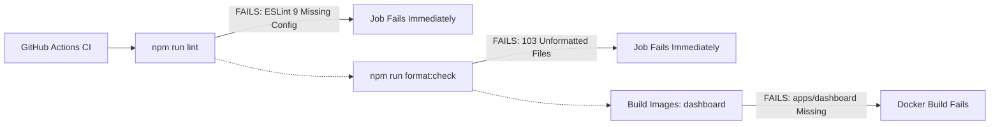

# Setu Platform — Testing & CI/CD Pipeline Audit

## 1. Test Architecture Assessment

### 1.1 Existing Test Coverage

Setu maintains a centralized test suite located in `tests/`:

- `tests/enforcement/foundation.test.ts` (5 tests) — Verifies Postgres role permissions (`NOBYPASSRLS`) and `withContext` transaction isolation.
- `tests/services/consent.test.ts` (15 tests) — Tests purpose registration, consent granting, active artifact superseding, and revocation.
- `tests/services/storage.test.ts` (14 tests) — Tests object creation, purpose filtering, and content retrieval.
- `tests/services/metering.test.ts` (17 tests) — Tests closed meter validation and usage aggregation.
- `tests/services/audit.test.ts` (11 tests) — Tests hash chain append, sequencing, and tampering detection.
- `tests/services/data.test.ts` (20 tests) — Tests collection declaration, RLS enforcement, dynamic masking views, and keyset pagination.
- `tests/services/auth.test.ts` (16 tests) — Tests API key issuance, OTP challenge verification, and refresh token rotation.
- `tests/cross-service/gateway.test.ts` (12 tests) — Tests Gateway HTTP socket proxy to Data service with HMAC signing.
- `tests/services/workflow.test.ts` (22 tests) — Tests sequential workflow steps, distributed leasing, and retry logic.
- `tests/services/functions.test.ts` (21 tests) — Tests function invocation, timeouts, and memory ceilings.

**Total passing tests:** **153 / 153 tests pass.**

### 1.2 Testing Strengths

1. **Real Database Integration:** Tests run against real PostgreSQL (`pgvector/pgvector:pg16`), verifying actual database query plans, RLS rules, and SQLSTATE behavior rather than mocked queries.
2. **Schema-Per-Test Isolation:** `tests/helpers/fixtures.ts` provisions a unique project schema (`setu_test_<random>`) per test file and drops it on teardown.
3. **Negative Security Testing:** Explicit tests verify that `setu_runtime` cannot bypass RLS, that invalid HMAC signatures are rejected with 401, and that filtering on a masked column is rejected with 400.

### 1.3 Critical Testing Gaps

1. **Zero Client SDK Tests:** `packages/sdk` has no test files whatsoever. As a result, catastrophic defects (such as the SDK generating invalid URLs like `/data/:table`) were never detected by automated testing.
2. **Empty Service Test Directories:** `services/*/__tests__` exist across all 9 services, but each directory contains **only a `.gitkeep` file**.
3. **No Concurrency / Load Tests:** There are no load or stress tests measuring the impact of `pg_advisory_xact_lock` or Argon2id CPU starvation under 100+ concurrent requests.
4. **No Network Failure / Chaos Tests:** No tests verify behavior when PostgreSQL drops connections or when downstream services time out.

---

## 2. CI/CD Pipeline Audit

### 2.1 GitHub Actions Workflow: `.github/workflows/ci.yml`

The CI pipeline consists of three sequential jobs:

1. `lint-and-typecheck`: runs `npm ci`, `npm run lint`, `npm run format:check`, `npm run typecheck`.
2. `test`: spins up a PostgreSQL container service and runs `npm test`.
3. `build-images`: builds Docker images across a matrix of 10 services on pushes to `main`.

### 2.2 Critical Pipeline Failures

1. **Step `Lint` Fails Unconditionally:**
   - Command: `eslint . --ext .ts,.tsx`
   - Error: `ESLint: 9.39.5. ESLint couldn't find an eslint.config.(js|mjs|cjs) file.`
   - Cause: ESLint 9 removed the legacy configuration format and the `--ext` flag. There is no `eslint.config.js` in the repository.
2. **Step `Format check` Fails on 103 Files:**
   - Command: `prettier --check .`
   - Result: Fails on 103 files across the repository.
3. **Step `Build Docker Images` Fails for `dashboard`:**
   - Matrix entry `dashboard` attempts to build `deploy/docker/dashboard.Dockerfile`.
   - The Dockerfile attempts to `COPY apps/dashboard/package.json apps/dashboard/`.
   - `apps/dashboard/` does not exist in the repository, resulting in fatal build failure.
4. **Missing Container Registry Push:**
   - Lines 106–108 have image push commands commented out (`# TODO: Push to container registry`).
5. **No Release or Deployment CD:**
   - No Continuous Deployment workflow exists. There is no automated deployment to Kubernetes, Helm packaging, or staging environment updates.
